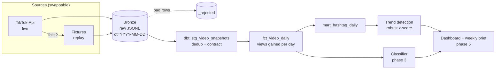

# AI Video Observatory

A daily data pipeline that tracks AI-generated videos trending on TikTok, classifies them (which tool made it, format, hook, niche) and flags trends **while they are still emerging**, before they peak.

> Status: phase 1 (pipeline skeleton running end to end on synthetic data). See the roadmap below.

## Why

AI video formats rise and die in days. By the time a format is obvious on your feed, it has already peaked. This project treats the trending feed as a time series: it snapshots the same videos every day, measures how fast each hashtag gains views and raises a flag when a tag breaks away from its own recent baseline.

## Architecture



## Design decisions

| Decision | Why |
|---|---|
| **Every source behind one interface** (`fetch` + `normalize`) | Unofficial TikTok access breaks often. A broken collector is swapped or falls back to the next one in the list without touching the rest of the pipeline. |
| **Raw payload stored next to the normalized row** | If the mapping changes, history is reprocessed from bronze without collecting again. |
| **Daily snapshots, never overwritten** | Velocity (views gained per day) only exists if yesterday's numbers are kept. |
| **Contract violations are quarantined, not dropped** | Rows that fail the Pydantic contract land in `_rejected/` with the error, so data loss is visible and countable. |
| **Idempotent writes** | Re-running a day replaces that day's file atomically. Backfills and retries are safe. |
| **Data tests in dbt** | Uniqueness, non-negative metrics, monotonic views and a volume-collapse check run on every build. |
| **Robust statistics** | Median/MAD instead of mean/std, so one viral outlier in the baseline does not hide the next breakout. |
| **Synthetic fixtures** | Tests, CI and the demo run without TikTok, and no real user data lives in the repo. |

## Quickstart

```bash
python -m venv .venv && .venv/Scripts/activate   # source .venv/bin/activate on macOS/Linux
pip install -e ".[dev]"

# 1. land 14 days of synthetic data
observatory ingest --sources fixture --start 2026-10-01 --end 2026-10-14

# 2. build and test the warehouse (DuckDB file at data/observatory.duckdb)
dbt build --project-dir transform --profiles-dir transform

# 3. which hashtags are breaking out on the latest day?
observatory trends
```

The synthetic data hides one story: `#aiasmr` is a minor tag until 2026-10-13 and then takes off. Step 3 finds it with a score of ~56. It also flags `#runway` and `#aiart`, and that is a real limitation worth knowing: about 90% of their gain that day comes from videos that are also tagged `#aiasmr`. Tags that ride along with a breakout inherit it. Phase 4 addresses this by scoring each tag on the views it gains *without* the breaking tag.

To collect live data instead: `pip install -e ".[tiktok]"`, `python -m playwright install`, then `observatory ingest` (defaults to `tiktokapi`, falling back to `fixture`).

## Project layout

```
src/observatory/
  models.py          data contracts (VideoSnapshot, VideoLabels)
  sources/           one adapter per collector
  ingest.py          bronze layer with fallback and quarantine
  trends.py          emerging-trend detection
  cli.py             `observatory ingest | trends`
transform/           dbt project (staging -> facts -> marts, data tests)
fixtures/            synthetic payloads, regenerated by scripts/make_fixtures.py
tests/               pytest
```

## Roadmap

- [x] **Phase 1, skeleton**: swappable sources, bronze layer, dbt models and data tests, baseline trend detection, CI.
- [ ] **Phase 2, live collection**: scheduled daily run (orchestrator with retries and alerts), second live source as fallback, collection health metrics.
- [ ] **Phase 3, classification**: multimodal model labels each video against `VideoLabels`; a hand-labelled evaluation set measures agreement (Cohen's kappa) before any label is trusted.
- [ ] **Phase 4, better detection**: change-point detection and a forecast baseline, co-occurrence correction for ride-along tags; backtest how many days before the peak each method fires.
- [ ] **Phase 5, outputs**: public dashboard on GitHub Pages and an automated weekly brief of emerging formats.

## Data and ethics

Only public, aggregate signals are used (counts, hashtags, captions). No personal data beyond public handles is stored, nothing is redistributed, and the repository itself ships synthetic data only. Live collection uses an unofficial client: respect the platform's terms and rate limits.
